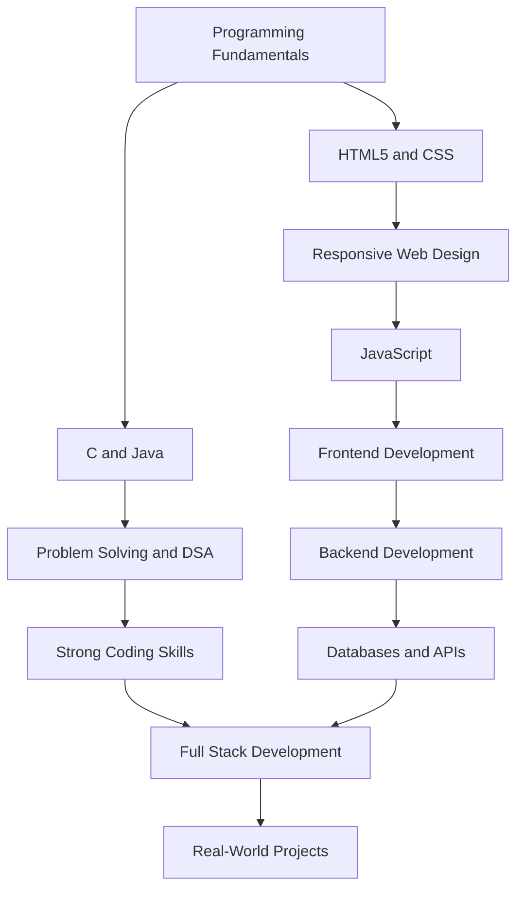

Copy the entire code below and paste it into your GitHub profile repository’s `README.md` file. Replace `YOUR_GITHUB_USERNAME` with your actual GitHub username.

markdown
````

<div align="center">


<a href="https://github.com/YOUR_GITHUB_USERNAME">

</a>

<p>


</p>

</div>

---

## 👨‍💻 About Me

Hi, I'm **Aditya Yadav**, an aspiring Software Developer passionate about programming, problem-solving, and building useful applications.

I'm continuously strengthening my programming fundamentals and working toward becoming a **Full-Stack Developer (FSD)**. I believe in learning by doing, writing clean code, and improving a little every day.

```java
class AdityaYadav {
    String role = "Aspiring Software Developer";

    String[] languages = {"C", "Java"};
    String[] webTechnologies = {"HTML5", "CSS"};

    String[] interests = {
        "Problem Solving",
        "Full Stack Development",
        "Software Development",
        "Continuous Learning"
    };

    String goal =
        "Build useful software and become a better developer every day.";
}
```

- 💻 Learning and practicing C and Java.
- 🌐 Building a foundation in HTML5 and CSS.
- 🧠 Improving logical thinking and problem-solving skills.
- 🚀 Continuously learning toward Full-Stack Development.
- 📚 Exploring new concepts and applying them through projects.

---

## 🧰 Tech Stack

<div align="center">

### Programming Languages


### Web Technologies


### Tools


</div>

---

## 🧭 My Learning Roadmap



| Focus Area | Learning Direction |
|---|---|
| Programming | C and Java fundamentals |
| Problem Solving | Logic, algorithms, and DSA |
| Frontend Development | HTML5, CSS, and JavaScript |
| Backend Development | Learning backend technologies |
| Full-Stack Development | Frontend, backend, databases, and APIs |
| Professional Growth | Git, GitHub, projects, and communication |

*This roadmap represents my learning journey and goals, not a claim that every technology is already mastered.*

---

## 🎯 Current Focus

- 💻 Strengthening programming fundamentals in C and Java.
- 🧠 Practicing problem-solving and logical thinking.
- 🌐 Learning HTML5 and CSS to build responsive websites.
- 🚀 Working toward Full-Stack Development.
- 📝 Writing clean code and documenting what I learn.

---

## 🚀 What I Want to Build

| Project Type | Goal |
|---|---|
| 🧩 Coding Problems | Improve logic and algorithmic thinking |
| ☕ Java Projects | Build applications using Java fundamentals |
| 🌐 Responsive Websites | Create clean, mobile-friendly web interfaces |
| 🛠️ Developer Tools | Build programs that solve practical problems |
| 🚀 Full-Stack Applications | Connect frontend, backend, and databases |

---

## 📌 Featured Projects

| Project | Description | Technology | Status |
|---|---|---|---|
| C Programming Practice | Programs demonstrating programming fundamentals | `C` | 🚧 Learning |
| Java Practice | Programs covering Java and OOP fundamentals | `Java` | 🚧 Learning |
| Responsive Website | A website with a clean, responsive design | `HTML5` `CSS` | 🔵 Planned |
| Full-Stack Application | An application with frontend, backend, and database integration | `Future Stack` | 🔵 Planned |

---

## 📊 Problem-Solving Journey

| Topic | Status |
|---|---|
| Programming Fundamentals | 🟢 Practicing |
| C Programming | 🟢 Practicing |
| Java Fundamentals | 🟢 Learning |
| HTML5 and CSS | 🟢 Learning |
| Data Structures and Algorithms | 🔵 Learning Goal |
| JavaScript | 🔵 Upcoming |
| Full-Stack Development | 🔵 Future Goal |

---

## 📈 GitHub Stats

<div align="center">


</div>

---

## 🐍 Contribution Snake

<div align="center">

<picture>
  <source media="(prefers-color-scheme: dark)" srcset="https://raw.githubusercontent.com/YOUR_GITHUB_USERNAME/YOUR_GITHUB_USERNAME/output/github-snake-dark.svg"/>
  <source media="(prefers-color-scheme: light)" srcset="https://raw.githubusercontent.com/YOUR_GITHUB_USERNAME/YOUR_GITHUB_USERNAME/output/github-snake.svg"/>
  
</picture>

</div>

---

## 💡 Principles I Follow

- **Fundamentals first:** Understand the basics before moving to advanced concepts.
- **Learn by building:** Turn concepts into practical projects.
- **Consistency over intensity:** Improve through regular practice.
- **Think before coding:** Understand the problem before writing the solution.
- **Keep improving:** Learn from mistakes and feedback.

---

## 🤝 Let's Connect

<div align="center">

<a href="https://github.com/YOUR_GITHUB_USERNAME">

</a>

<a href="https://www.linkedin.com/">

</a>

<br/><br/>

<i>Think logically. Code consistently. Build meaningfully. Keep learning.</i>


</div>
````

Important: The GitHub stats and contribution snake will work after you replace `YOUR_GITHUB_USERNAME`. The snake animation also requires setting up a GitHub Actions workflow in your profile repository.
